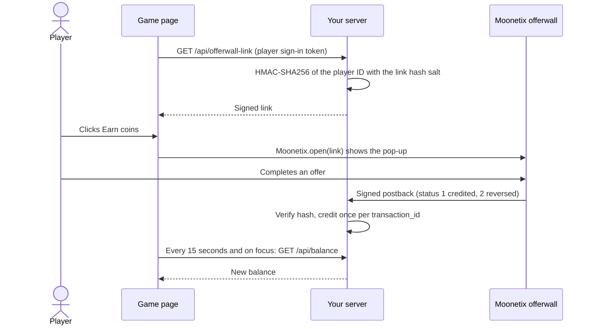

# Moonetix offerwall: HTML5 game example

**A small Phaser 3 browser game with an Earn coins button that opens the Moonetix offerwall in a pop-up over the game.**

[](https://github.com/moonetix/offerwall-html5-game/actions/workflows/ci.yml)
[](https://moonetix.com)
[](LICENSE)
[](https://docs.moonetix.com/offerwall-link#own-button)
[](https://moonetix.com/academy/monetization/monetize-html5-web-game)
[](https://moonetix.com/industries/games)
[](https://moonetix.github.io/offerwall-html5-game/)

Star Catcher is a tiny [Phaser](https://phaser.io) game. A Node.js server signs the [Moonetix](https://moonetix.com) offerwall link, credits coins from postbacks and returns the balance. Earn coins opens the offerwall with `Moonetix.open(link)` from `https://wall.moonetix.com/embed.js`, so players never leave the page.

The [live demo](https://moonetix.github.io/offerwall-html5-game/) runs the same game without a server: the offers are made up, and each postback goes through `src/postback.js` in your browser so you can watch the hash check and the credit-once rule.

Moonetix is an affiliate network. Players earn your coins by completing offers, and you earn per completed offer. To run it you need an App ID and keys: see [Sign up](#sign-up).

## What it shows

- One script tag and one `Moonetix.open` call. The pop-up closes with its close button, Escape or a click outside, and the game keeps its state.
- The game only reads the balance. Coins are added on the server from signed postbacks, each `transaction_id` once, and a reversal takes back exactly what was credited.
- No npm packages, Phaser pinned to 3.90.0 with Subresource Integrity, a strict Content Security Policy, and 23 tests against real Moonetix postbacks.

## The flow



## Run it

You need Node.js 22.13 or later and an approved Moonetix app.

```bash
git clone https://github.com/moonetix/offerwall-html5-game.git
cd offerwall-html5-game
cp .env.example .env      # put your App ID, link hash salt and postback secret key in .env
npm start                 # http://localhost:3000
```

| Variable | Required | Default | Purpose |
| --- | --- | --- | --- |
| `MOONETIX_APP_ID` | yes | | App ID from Offerwalls, your offerwall, Integration |
| `MOONETIX_LINK_SALT` | yes | | Link hash salt from the same page. Server only. |
| `MOONETIX_POSTBACK_KEY` | yes | | Postback secret key from the Postback page. Server only. |
| `PORT` | no | `3000` | HTTP port |
| `DATABASE_PATH` | no | `./data.sqlite` | SQLite file for players, balances and transactions |
| `CURRENCY_NAME` | no | `Coins` | Currency label returned by `/api/balance` |

The server refuses to start without the three required values. The browser side has no configuration: the page talks only to its own origin, and the poll interval is `POLL_MS` (15 seconds) in `public/game.js`.

Save this postback URL on the Postback page:

```text
https://YOUR_HOST/moonetix/postback?user={user_id}&tx={transaction_id}&event={event_id}&status={status}&reward={reward}&payout={payout}&offer={offer_name}&hash={hash}
```

The pop-up loads the offerwall only on https pages of the website you registered for your app and its subdomains. On `http://localhost` the game opens the same signed link in a new tab instead, which works everywhere. Deploy behind https on your registered domain to see the pop-up.

## How the pieces connect

1. The first time the player clicks Earn coins, the page asks them to confirm they are 16 or older. The server then creates a guest player and returns a random sign-in token, which the page keeps in `localStorage`.
2. The page asks `/api/offerwall-link` for the signed link. The server picks the player from the sign-in token, never from a field the page sends, and signs the player ID with the link hash salt. The salt never reaches the browser.
3. Earn coins checks that the link starts with `https://wall.moonetix.com/` and calls `Moonetix.open(link)`. The button works from the mouse, touch, or the E key.
4. The player completes an offer. Moonetix calls `/moonetix/postback`. The server checks the hash first, credits status 1 once per `transaction_id`, takes the stored amount back on status 2, and answers 200 only after the change is saved.
5. The page reloads the balance every 15 seconds while it is visible and when it gets focus back, because some offers credit minutes later. The coin counter pulses when it goes up.

| Path | Purpose |
| --- | --- |
| `public/index.html` | Page, pinned Phaser, `embed.js`, age check |
| `public/game.js` | The game, the HUD and the Earn coins button |
| `src/moonetix.js` | Signed link, postback hash, exact amounts |
| `src/postback.js` | Postback handler |
| `src/store.js` | SQLite players, balances, transactions |
| `src/server.js` | HTTP routes, static files, Content Security Policy |

The guest sign-in is only here so the example runs on its own. On your site, let the server take the player from your existing login, and use the account ID your wallet uses.

## Security choices

- The link hash salt and the postback secret key are read from environment variables on the server. Never build the hash in JavaScript in the browser.
- The link belongs to the player of the sign-in token. A `user_id` the page sends is ignored.
- The postback hash is checked with a constant-time comparison before anything else. A missing hash gets 400, a wrong one 403.
- `transaction_id` is the primary key of the transactions table, so a retry cannot credit twice. The credit and the balance change run in one database transaction.
- A reversal subtracts the stored amount, only for a transaction that was credited to the same player. Balances can go below zero after a reversal; say in your terms that rewards can be taken back.
- The page never adds coins itself. Anything in client-side JavaScript can be changed by the player.
- The Content Security Policy allows scripts only from this server, jsDelivr and `wall.moonetix.com`, frames only from `wall.moonetix.com`, and requests only to this server. Phaser loads with a `sha384` integrity hash.
- Only a SHA-256 hash of each sign-in token is stored. Amounts are integers in millionths of a coin, so `0.375` adds up exactly.

## Where an offerwall may run

- **Web game portals:** CrazyGames, Poki and GameDistribution allow only their own ad SDK in the build you give them. An offerwall, or a button that links to one, can cost you the listing or the revenue share. Ship a clean portal build and keep the Earn button in the build on your own site. See [Best offerwall for HTML5 and web games](https://moonetix.com/academy/monetization/best-offerwall-for-web-games) and [How to monetize an HTML5 web game](https://moonetix.com/academy/monetization/monetize-html5-web-game).
- **itch.io and other storefronts:** read their current content and monetization rules before you upload. Keep the earn screen optional and never in the way of play.
- **Steam:** Valve does not support advertising models in Steam games. If you wrap the game for Steam, leave the offerwall out. See [Can you put ads in a Steam game?](https://moonetix.com/academy/monetization/ads-in-steam-games)
- **Console stores** have their own certification rules. Check them before you ship an earn screen.
- Rewards are only for completed offers, never for invites, likes, reviews or other engagement. Players must be 16 or older, with a parent's permission under 18.

## Tests

```bash
npm test
```

Fake keys, no network, an in-memory database. The tests check:

- that the signed link is identical to the link the Moonetix code builds for the same test keys, for the signed-in player only;
- that a player is created only after the 16+ confirmation, and that only a hash of the sign-in token is stored;
- real postbacks produced by the Moonetix postback code (`test/fixtures/moonetix-vectors.json`): credit, retry, the same credit 10 times at once, decimal rewards, reversal, repeated reversal, a credit after its reversal, a reversal for another player, a `test_` reversal that was never credited, unknown players, tampered, wrongly signed and unsigned postbacks, and a storage failure that answers 500;
- that the page loads Phaser 3.90.0 with an integrity hash and `embed.js`, under the Content Security Policy, and that no secret reaches the browser.

The test values are fake: app ID `demoapp0000000000000001`, link salt `test_link_salt_not_secret`, postback key `test_postback_key_not_secret`.

To check a running server from the outside, create a player in the game, then point [postback-tester](https://github.com/moonetix/postback-tester) at it. It sends Moonetix-signed credits, retries, reversals, forged and unsigned postbacks and five parallel copies of one credit, and exits 1 on the first rule the handler breaks:

```bash
export MOONETIX_POSTBACK_KEY=your-postback-secret-key   # same value as in .env
npx github:moonetix/postback-tester --preset moonetix \
  'http://localhost:3000/moonetix/postback?user={user_id}&tx={transaction_id}&event={event_id}&status={status}&reward={reward}&payout={payout}&offer={offer_name}&hash={hash}' --user 1
```

## Checking with a real postback

1. Open the game and click Earn coins. Confirm the age check. Your player ID is 1 on a fresh database.
2. In the dashboard, open Offerwalls, your offerwall, Integration. Under Integration status, use Check a link, then Test a link with user ID `1`, and compare it with what `/api/offerwall-link` returns. They must match, apart from the `sub1=html5` tracking value.
3. Click **Send a test postback** with user ID `1` and status 1. You can also send one from the Postback page. Within 15 seconds the coin counter goes up once.
4. A status 2 test gets a new `test_` transaction ID that was never credited, so the server answers 200 and changes nothing.
5. Test from a normal home or mobile connection. The offerwall blocks VPNs, proxies, Tor and data center networks.
6. Before launch, remove the test rewards from your test account.

## When something does not work

| Symptom | Cause |
| --- | --- |
| `node: .env: not found` on `npm start` | Copy `.env.example` to `.env` first. |
| `Missing environment variables: ...` | One of the three required values is empty in `.env`. |
| Earn coins opens a new tab, not the pop-up | Expected on `http://` and on any host other than the site registered for your app. Serve the game over https on that domain. |
| `/api/offerwall-link` answers 401 `sign_in_required` | The page has no sign-in token yet, or `localStorage` was cleared. Click Earn coins and confirm the age check again. |
| Postback answers 403 `invalid hash` | `MOONETIX_POSTBACK_KEY` does not match the Postback page, or a proxy changed the query string. The hash covers `tx`, `user`, `reward` and `status` exactly as sent. |
| Postback answers 200 `ignored: unknown user` | The user ID is not a numeric player ID, for example `test_user` from a dashboard test. Send the test with your real player ID. |

## Read next

- Guide: [How to monetize an HTML5 web game](https://moonetix.com/academy/monetization/monetize-html5-web-game)
- Guide: [Best offerwall for HTML5 and web games](https://moonetix.com/academy/monetization/best-offerwall-for-web-games)
- Guide: [Add a floating Earn button to any website](https://moonetix.com/academy/integrations/floating-earn-button)
- Moonetix for games: [moonetix.com/industries/games](https://moonetix.com/industries/games). Website integration: [moonetix.com/integrations/website](https://moonetix.com/integrations/website)
- Docs: [Offerwall link, embed and button](https://docs.moonetix.com/offerwall-link), [Postbacks](https://docs.moonetix.com/postbacks), [Credits and reversals](https://docs.moonetix.com/credits-and-reversals), [Testing](https://docs.moonetix.com/testing)
- Free tools: [Offerwall link builder](https://moonetix.com/tools/offerwall-link-builder) and [Postback hash checker](https://moonetix.com/tools/postback-hash-checker)

## Sign up

Create a publisher account at https://moonetix.com/register?from=github-offerwall-html5-game. Each application gets a manual review. When yours is approved, add the site where the game runs as an app, set the coin name and rate, and fill in `.env`.

## More Moonetix examples

- **Start here:** [awesome-offerwalls](https://github.com/moonetix/awesome-offerwalls), [offerwall-postback-handlers](https://github.com/moonetix/offerwall-postback-handlers)
- **Games:** [offerwall-unity-example](https://github.com/moonetix/offerwall-unity-example), [offerwall-godot](https://github.com/moonetix/offerwall-godot), [moonetix-unity](https://github.com/moonetix/moonetix-unity)
- **Mobile:** [moonetix-android-sdk](https://github.com/moonetix/moonetix-android-sdk), [moonetix-ios-sdk](https://github.com/moonetix/moonetix-ios-sdk), [moonetix-flutter](https://github.com/moonetix/moonetix-flutter), [moonetix-react-native](https://github.com/moonetix/moonetix-react-native), [offerwall-flutter-example](https://github.com/moonetix/offerwall-flutter-example), [offerwall-react-native-example](https://github.com/moonetix/offerwall-react-native-example)
- **Web and backends:** [offerwall-nextjs-starter](https://github.com/moonetix/offerwall-nextjs-starter), [offerwall-react-vite](https://github.com/moonetix/offerwall-react-vite), [offerwall-vue-nuxt](https://github.com/moonetix/offerwall-vue-nuxt), [offerwall-express](https://github.com/moonetix/offerwall-express), [offerwall-laravel](https://github.com/moonetix/offerwall-laravel), [offerwall-django](https://github.com/moonetix/offerwall-django), [offerwall-firebase-functions](https://github.com/moonetix/offerwall-firebase-functions), [offerwall-supabase](https://github.com/moonetix/offerwall-supabase), [rewards-site-starter](https://github.com/moonetix/rewards-site-starter), [moonetix-offerwall-wordpress](https://github.com/moonetix/moonetix-offerwall-wordpress)
- **Communities and desktop:** [telegram-mini-app-offerwall](https://github.com/moonetix/telegram-mini-app-offerwall), [discord-rewards-bot](https://github.com/moonetix/discord-rewards-bot), [offerwall-chrome-extension](https://github.com/moonetix/offerwall-chrome-extension), [offerwall-electron](https://github.com/moonetix/offerwall-electron)
- **Tools and data:** [postback-tester](https://github.com/moonetix/postback-tester), [signup-guard](https://github.com/moonetix/signup-guard), [datacenter-ip-ranges](https://github.com/moonetix/datacenter-ip-ranges), [reward-economy-kit](https://github.com/moonetix/reward-economy-kit), [referral-engine](https://github.com/moonetix/referral-engine), [gamification-kit](https://github.com/moonetix/gamification-kit), [offerwall-fraud-playbook](https://github.com/moonetix/offerwall-fraud-playbook), [affiliate-postback-macros](https://github.com/moonetix/affiliate-postback-macros), [country-tiers](https://github.com/moonetix/country-tiers)

## License

MIT. See [LICENSE](LICENSE). Phaser is MIT licensed by Phaser Studio and is loaded from jsDelivr, not bundled.
